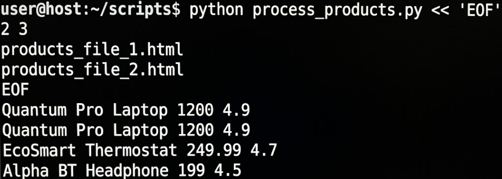
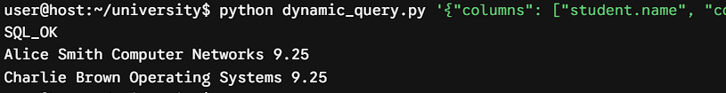
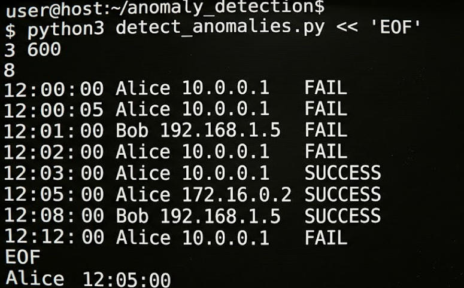
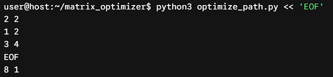
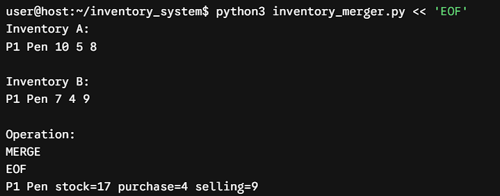

# 💻 Python Programming Assignment

## 📝 Advanced Programming with Python
### *Data Structures | Concurrency | GUI | Complete Academic Repository*


---

## 👨‍🎓 Student Details

| Field | Details |
|------|--------|
| 👤 Name | Om H Machhi |
| 🆔 Enrollment No | 12502080603013 |
| 🎓 Semester | 5th |
| 📅 Academic Year | 2026-27 |

---

## 📑 Assignment Overview
This repository contains a suite of **production-grade Python implementations** designed to fulfill core university competencies and placement outcomes (CO/PO/PSO). The programs cover comprehensive paradigms including:

✨ Compound Data Structures & Custom Aggregations  
✨ Text Search Automation (Trie / Aho-Corasick Automata)  
✨ Recursive Parsers & Dynamic Memoization  
✨ Robust File Streaming Channels & Structural Error Logs  
✨ Object-Oriented Banking Architecture & Atomic Rollback Checkpoints  
✨ Graph Theory Algorithms & Priority Queue Topological Sorts  
✨ Custom Application Exception Trees & Interactive Validation Engines  
✨ Binary Pickling Indexes & Compressed Archiving Pipelines  
✨ High-Performance Event-Driven Thread Simulation Heaps  
✨ Multi-Widget Desktop GUI Architecture & JSON Local Storage Systems  
✨ Regular Expressions & Web Scraping Automation Engines  
✨ Relational Database Management & SQL Query Transformers  
✨ Matrix Dynamic Programming & Operator Overloading Paradigms  

---

# 📘 Core Lab Exercises

---

## 📂 Assignment 1: Core Paradigms

### 🔹 Program 1: Campus Merit Analyzer
📌 Grouped Sorting • Dynamic Multi-Key Tie Breaking  

<p align="center">
  
</p>

---

### 🔹 Program 2: Optimized Password Auditor
📌 Trie Structures • Aho-Corasick Substring Automaton  

<p align="center">
  
</p>

---

### 🔹 Program 3: Recursive Expression Engine
📌 Parsing Stacks • Cycle Detection • Result Memoization  

<p align="center">
  
</p>

---

### 🔹 Program 4: Exception-Safe CSV Splitter
📌 File I/O Streaming • Runtime Token Data Validation  

<p align="center">
  
</p>

---

### 🔹 Program 5: Object-Oriented Settlement Engine
📌 Encapsulation Modifiers • Batch Checkpoints • Transaction Rollbacks  

<p align="center">
  
</p>

---

### 🔹 Program 6: Module Dependency Resolver
📌 Kahn's Topological Sorting • Min-Heap Scheduling • DFS Path Extraction  

<p align="center">
  
</p>

---

### 🔹 Program 7: Interactive Formula Validator
📌 Token Parsing • Custom Application Exception Trees  

<p align="center">
  
</p>

---

### 🔹 Program 8: Compressed Log Indexer
📌 Inverted Positional Mapping • Binary Pickling • Deflated Zip Archives  

<p align="center">
  
</p>

---

### 🔹 Program 9: Threaded Job Scheduler Simulation
📌 Event-Driven Timeline Loops • Priority Allocation Balanced Heaps  

<p align="center">
  
</p>

---

### 🔹 Program 10: Tkinter Tracker & File Persistence
📌 Virtual Treeview Grid Rendering • Live Index Search Filters • JSON Storage  

<p align="center">
  
</p>

---

## 📂 Assignment 2: Advanced Integration & Data Automations

### 🔹 Program 1: Regex-Based Email Intelligence Extractor
📌 Text Pattern Parsing • Metacharacter Filters • Domain Analysis  

<p align="center">
  
</p>

---

### 🔹 Program 2: Offline Web Scraping Ranker from HTML Pages
📌 DOM Node Traversal • Element Filtering • Custom Metric Sorting  

<p align="center">
  
</p>

---

### 🔹 Program 3: MySQL Student-Course Analytics Engine
📌 Database Relational Models • Analytical Aggregations • Key Constraints  

<p align="center">
  
</p>

---

### 🔹 Program 4: SQL Join Query Builder and Validator
📌 Dynamic Query Compilers • Syntax Safety Controls • Join Type Translators  

<p align="center">
  
</p>

---

### 🔹 Program 5: Tkinter Contact Manager with MySQL Backend
📌 Stateful GUI Form Binding • RDBMS CRUD Controls • Event Binding  

<p align="center">
  
</p>

---

### 🔹 Program 6: Log Anomaly Detector using Sliding Window
📌 Stream Windows • Outlier Identification Thresholds • Dynamic State Trackers  

<p align="center">
  
</p>

---

### 🔹 Program 7: Generator-Based JSON ETL Pipeline
📌 Memory-Efficient Yields • Lazy Transformation Streams • Large Scale Processing  

<p align="center">
  
</p>

---

### 🔹 Program 8: Matrix Path Optimizer with Dynamic Programming
📌 Optimal Substructure Overlaps • Grid State Memos • Path Tracing Matrices  

<p align="center">
  
</p>

---

### 🔹 Program 9: OOP Inventory Merger with Operator Overloading
📌 Dunder Method Injectors • Magic Polymorphism Overrides • In-Place Mutation Guards  

<p align="center">
  
</p>

---

### 🔹 Program 10: Python Data Visualization Dashboard Exporter
📌 Statistical Chart Renderers • Multi-Axes Planners • Static File Importers  

<p align="center">
  
</p>

---

# 📁 Repository Structure
```text
Python-Programming-Assignment/
│
├── ASS-1/
│   ├── p1.py to p10.py
│   └── op1.png to op10.png
│
├── ASS-2/
│   ├── p1.py to p10.py
│   └── op1.png to op10.png
│
└── README.md
```
